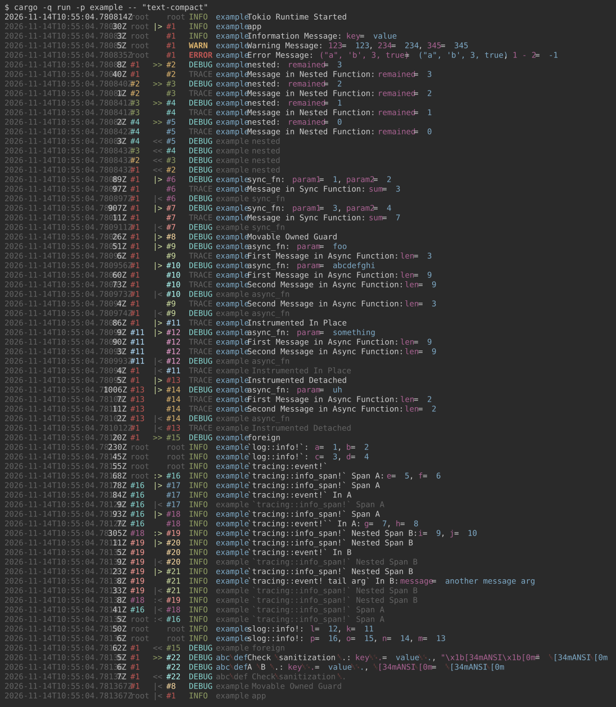

# `polog`: A performance-oriented structured logging facade

[](https://github.com/zheland/polog/actions)
[](https://crates.io/crates/polog)
[](https://docs.rs/polog)
[](https://codecov.io/gh/zheland/polog)
[](https://deps.rs/repo/github/zheland/polog)
[](https://crates.io/crates/polog)
[](https://github.com/zheland/polog/#license)
[](https://blog.rust-lang.org/2026/11/12/Rust-1.100.0/)


The `polog` workspace provides a structured logging facade, optional
middleware, and a reference backend, designed for applications where
logging overhead matters and where threading an explicit logger through the
call graph is acceptable.

`polog` separates the call-site API from the backend handler, defers
formatting to the logger, and replaces thread-locals and dynamic dispatch
with explicit logger parameters and monomorphized calls.

A same-thread logger formats arguments in place.
An off-thread logger converts them into a `'static + Send` form once per
event and defers formatting until they are consumed.

[](crates/pologger/assets/terminal-captures/text-compact.svg)


## Workspace

| Crate | API Docs | README | Role |
|:--:|:--:|:--:|:--|
| [`polog`] | [API Docs][`polog`] | [README][polog-readme] | Facade traits and macros. |
| [`polog-util`] | [API Docs][`polog-util`] | [README][polog-util-readme] | Optional utilities and middleware. |
| [`pologger`] | [API Docs][`pologger`] | [README][pologger-readme] | Reference logger backend implementation. |

Each crate ships its own README with the sections that apply to it:
- [`polog`] has the API and macro documentation,
- [`polog-util`] has the  composition guide,
- [`pologger`] has the formatter and configuration reference.


## When to use `polog` and when not to

Choose `polog` if:
- You prefer explicit key‑value structured logs.
- You need minimal logging overhead, especially in hot paths.
- You are comfortable threading the logger explicitly through the call
  graph.
- You want the ability to log to be visible in function signatures, with no
  hidden thread‑local or global state.
- You log from many async tasks and want to avoid formatting before sending.
- You can afford slightly higher compile times for better runtime
  performance.
- You are building an application (not a library) where you control the
  logger.
- You want the macro layer to be replaceable: every call site expansion is
  composed from public functions and traits.

Avoid `polog` if:
- You rely on ambient span context: thread‑locals, a global logger, or
  `#[instrument]`-style automatic spans.
- You need compile‑time level filtering through Cargo features like
  `max_level_*` or `release_max_level_*`.
- You prefer an ergonomic "printf‑like" single‑message logging style.
- You are writing a library that must integrate with the existing
  `log`/`tracing` ecosystem.
- You do not want to thread a logger parameter through every function that
  may log or whose children may log.
- You need a structured-output backend (JSON, logfmt, protobuf) that keeps
  primitive types typed by default. `polog` delivers every argument as its
  `Display`-rendered text, so `123` arrives as `"123"`.
- You cannot accept the compile‑time and binary‑size impact of
  monomorphization.
- You need a mature ecosystem of log processors, formatters, and transports
  right now.


## Executable usage

In an executable, [`pologger::OffThreadLoggerBuilder`] builds a complete
off-thread logging chain from a single filter string: a `RUST_LOG`-style
filter, an offloader worker, a system-time enricher, and a text or NDJSON
formatter.

```toml
[dependencies]
polog = "0.1.0-alpha.1"
pologger = { version = "0.1.0-alpha.1", features = [ "log-0-4", "tracing-0-1" ] }
```

```rust
let (mut logger, config) =
    pologger::OffThreadLoggerBuilder::stderr_text("debug,foo=info,bar=trace")
        .register_as_global_log_logger(true)
        .register_as_global_tracing_subscriber(true)
        .build()
        .unwrap();

polog::info!(&mut logger, "Message 1"); // Printed
polog::trace!(&mut logger, "Message 2"); // Filtered out
polog::trace!(&mut logger, target: "foo", "Message 3"); // Filtered out
polog::trace!(&mut logger, target: "bar", "Message 4"); // Printed
```

The builder returns a logger that implements [`polog::Logger`]. Every `polog`
macro accepts `&mut logger` directly. The returned config shares three
`Arc<RwLock<...>>` handles with the live logger for filter, logger, and
formatter updates.


## Library usage

Libraries depend on `polog` only. They accept a logger parameter and pass
it down.
They never construct one and never depend on a backend.

```toml
[dependencies]
polog = "0.1.0-alpha.1"
```

```rust
fn do_smth<L>(logger: &mut L)
where
    L: polog::Logger,
{
    let logger = polog::info_span!(logger, "Span example");

    // ...

    polog::info!(logger, "Message 1"; int_type, string, key = lazy_evaluated() + 123);
    polog::info!(logger, "Message 2"; static_str_ref, :t non_static_str_ref);
    polog::warn!(logger, "Message 3"; :t ? slice_ref, :s ? any_type_impls_debug);

    // ...
}
```


## Comparison with Existing Crates

| Feature / Aspect | [`polog`] | [`log`] | [`tracing`] | [`slog`] |
|:----------------:|:---------:|:-------:|:-----------:|:--------:|
| Maturity | ⚠️ Not yet mature | ✅ Mature | ✅ Mature | ✅ Mature |
| Structured kv (key‑value) support | ✅ Supported | ✅ Supported | ✅ Supported | ✅ Supported |
| Span support | ✅ Span | ⛔️ No | ✅ Span | ⛔️ No |
| Context support | ✅ Context | ⛔️ No | ✅ Extensions | ✅ Context |
| Thread‑local span context | ⛔️ No | ⛔️ No | ✅ `Span::current()` | ⛔️ No |
| Dynamic span fields | ⛔️ No | ⛔️ No | ✅ `Span::record` | ⛔️ No |
| `#[instrument]` attribute | ⛔️ No | ⛔️ No | ✅ Yes | ⛔️ No |
| Deferred formatting of custom types | ✅ Supported | ⛔️ No | ⛔️ No | ⛔️ No |
| Single formatted message | ⛔️ No | ✅ Supported | ✅ Supported | ✅ Supported |
| Value bounds (without modifiers) | ✅ `IntoSendable + Display` | ✅ `log::kv::ToValue` | ⚠️ Sealed `tracing::Value` | ✅ `slog::Value` |
| Supports formatting modifiers | `%`, `?`, `#%`, `#?` | `:%`, `:?` | `%`, `?` | `%`, `?`, `#%`, `#?` |
| Structured value output | ⚠️ `Display` text<br>by default | ⚠️ Primitives | ⚠️ Primitives | ✅ `Serializer` |
| Sync logger overhead | ✅ None for generic logger | ⚠️ `&dyn VisitSource` | ⚠️ `&dyn Visit` | ⚠️ `&dyn KV` |
| Async logger overhead<br>for non‑primitive types| ✅ `IntoSendable` (can be no‑op) | ⚠️ `format!` | ⚠️ `format!` | ⚠️ `format!` |
| Static descriptor | ✅ Location, Level,<br>Message, Key names | ⛔️ No | ✅ Location, Level,<br>Message, Key names | ✅ Location, Level |
| Compile‑time filtering<br>via Cargo features | ⛔️ No | ✅ `max_level_*` | ✅ `max_level_*` | ✅ `slog‑max‑level-*` |
| Disabled events<br>eliminated at compile time | ⚠️ Via optimizer const‑folding | ✅ Always | ✅ Always | ✅ Always |
| Non‑const log level | ⚠️ Emulated by the macro codegen | ✅ Yes | ⛔️ No | ⛔️ No |
| Global logger support | ⛔️ No | ✅ Yes | ✅ Yes | ⛔️ No |
| Parameterized logger support | ✅ Yes | ✅ Yes | ⚠️ `with_dispatch` | ✅ Yes |
| API Complexity | ⚠️ Moderate<br>(send behavior modifiers) | ✅ Simple | ✅ Simple | ✅ Simple |
| Monomorphization | ✅ Full | ⚠️ `dyn`‑heavy API | ⚠️ `dyn`‑heavy API | ⚠️ `dyn`‑heavy API |
| Compile‑time impact | ⚠️ Potentially high,<br/>depends on monomorphization | ✅ Low | ⚠️ Moderate,<br/>complex macro codegen | ✅ Simple |
| Ecosystem | ⚠️ Only [`polog`], [`polog-util`]<br/>and [`pologger`] | ✅ Huge | ✅ Huge | ⚠️ Moderate |

The [`polog` README][polog-readme] documents each row in more detail and answers why the
facade makes the trade-offs it does.
It also runs a reproducible benchmark under `fixtures/codegen` across the
four facades in no-logging, format-to-buffer, and send-only modes.


## FAQ

### Which crate do I need?

- **A library.** `polog` only. Thread the logger, call the macros, do not
  construct a backend.
- **An application.** `polog` plus a backend. The simplest backend is
  `pologger`, and its `OffThreadLoggerBuilder` wires `polog-util`
  middleware automatically. Add `polog-util` as a direct dependency only
  when you compose the middleware chain by hand.
- **An application that already uses `log` / `slog` / `tracing`.**
  `pologger` plus `polog-util` for the bridge adapters. You do not need
  `polog` in every file; the bridges translate at the boundary.

See the FAQ in each crate README for the questions that apply to that
crate specifically:
- [`polog` FAQ][polog-faq] for design trade-offs,
- [`polog-util` FAQ][polog-util-faq] for composition,
- [`pologger` FAQ][pologger-faq] for formatter and sink choices.

### Why three crates?

The same split `log` / `log-*` and `tracing` / `tracing-subscriber` use:

- `polog` is the facade. It is the only crate a library should depend on.
  Every dependency a library adds is imposed on its downstream users, so
  the facade has to be small and stable.
- `polog-util` is optional middleware. Binaries add it when they need
  filtering, offloading, or fanout. Libraries that do not run their own
  logger never depend on it.
- `pologger` is a reference backend. It exists so that an application can
  get a working logger without writing a backend first, and so that the
  workspace has a concrete example of what a full `Handler` chain looks
  like.


## Documentation

- [`polog` API Documentation][`polog`]
- [`polog-util` API Documentation][`polog-util`]
- [`pologger` API Documentation][`pologger`]


## License

Licensed under either of

- Apache License, Version 2.0 ([LICENSE-APACHE](LICENSE-APACHE) or <https://www.apache.org/licenses/LICENSE-2.0>)
- MIT license ([LICENSE-MIT](LICENSE-MIT) or <https://opensource.org/licenses/MIT>)

at your option.


## Contribution

Unless you explicitly state otherwise, any contribution intentionally
submitted for inclusion in the work by you, as defined in the Apache-2.0
license, shall be dual licensed as above, without any
additional terms or conditions.


[`polog`]: https://docs.rs/polog/latest/polog/
[`polog-util`]: https://docs.rs/polog-util/latest/polog_util/
[`pologger`]: https://docs.rs/pologger/latest/pologger/
[`log`]: https://docs.rs/log/latest/log/
[`tracing`]: https://docs.rs/tracing/latest/tracing/
[`slog`]: https://docs.rs/slog/latest/slog/
[polog-readme]: crates/polog/README.md
[polog-util-readme]: crates/polog-util/README.md
[pologger-readme]: crates/pologger/README.md
[polog-faq]: crates/polog/README.md#faq
[polog-util-faq]: crates/polog-util/README.md#faq
[pologger-faq]: crates/pologger/README.md#faq
[`polog::Logger`]: https://docs.rs/polog/latest/polog/trait.Logger.html
[`pologger::OffThreadLoggerBuilder`]: https://docs.rs/pologger/latest/pologger/struct.OffThreadLoggerBuilder.html
