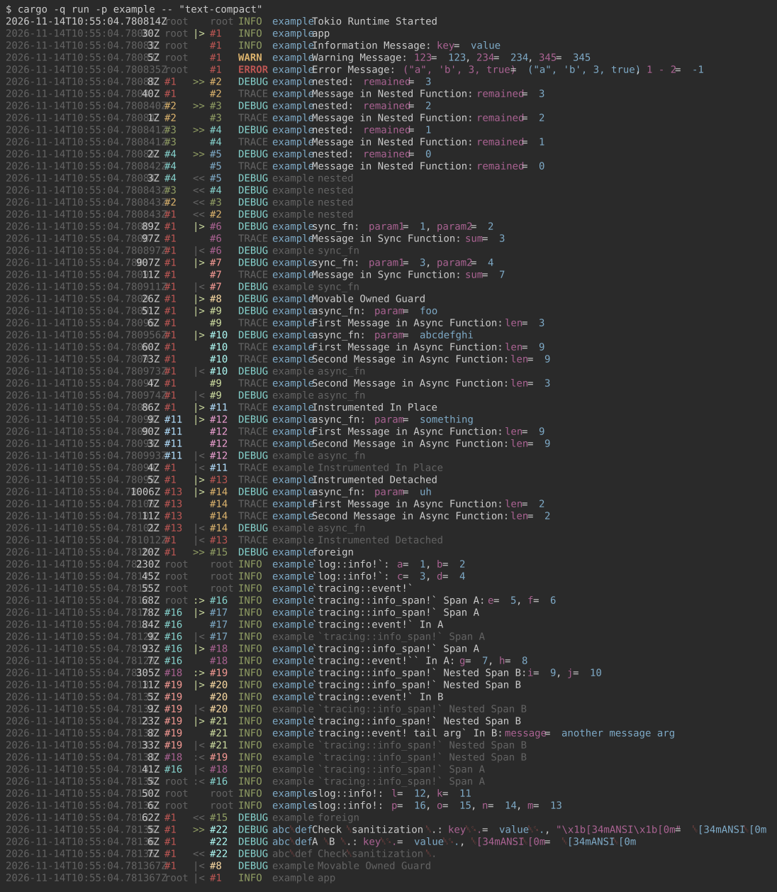
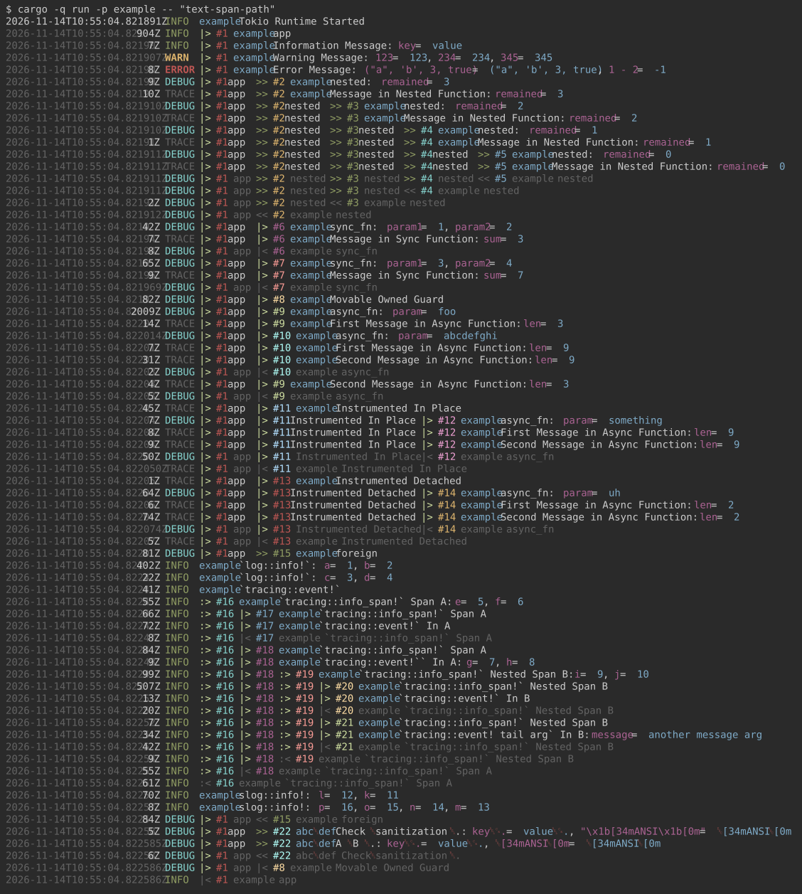
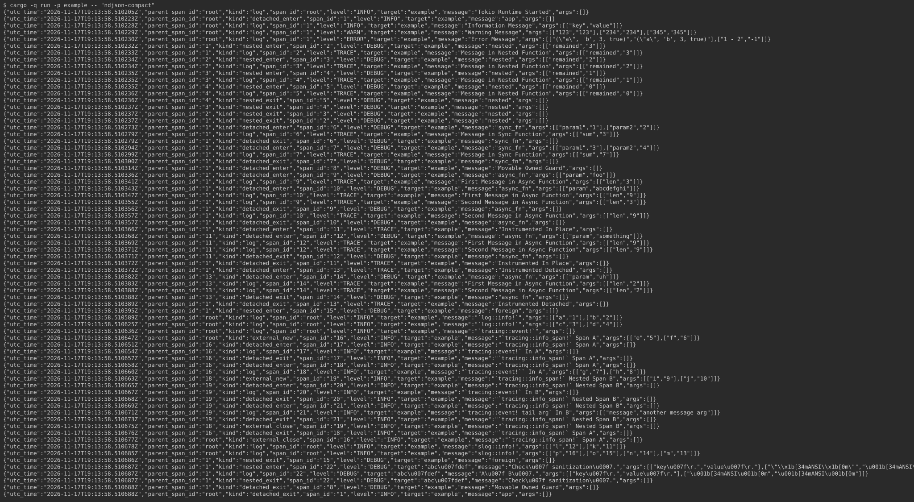

# `pologger`: A reference logging backend for `polog`

The `pologger` crate provides a reference logging backend for the [`polog`]
logging facade.

It renders `polog` events and spans as human‑readable text or
newline‑delimited JSON, with configurable flags to select which fields
are shown.

It also implements `log::Log`, `slog::Drain`, and `tracing::Subscriber`
when the corresponding feature is enabled, so it can serve as a single
sink for applications that use more than one logging facade.
All three integrations share the same `SpanIdGenerator` with the `polog`
chain, so span IDs are consistent across directions.

[](examples/example/src/main.rs)


## About

`pologger` is a reference logging backend for the [`polog`] facade.
It renders `polog` events and spans as human-readable text or
newline-delimited JSON, and can also serve `log`, `slog`, and `tracing`
events through the same sink.

[`Pologger`] is the backend [`Handler`] that renders events and spans.
[`OffThreadLoggerBuilder`] wires it into a complete off-thread logging chain
from a single filter string and returns a logger ready for `polog` macros.


## When to use `pologger` and when not to

Choose `pologger` if:
- You are starting a new application that uses `polog` and want a ready‑made
  chain.
- You need human‑readable text output for a terminal, or NDJSON output for a
  log aggregator.
- You want one process‑wide sink that serves `polog`, `log`, `slog`, and
  `tracing` simultaneously.
- You need live reconfiguration of the filter or rendering flags without
  rebuilding the logger.

Avoid `pologger` if:
- You do not use the `polog` facade at all. `pologger` is a backend for
  `polog`'s handler contract. Using it purely as a `log` / `tracing` /
  `slog` sink is possible via `SharedPologger`, but `pologger` then provides
  little over a direct facade-specific backend.
- You need a structured‑output backend that preserves typed primitives.
  `NdJsonFormatter` emits every value as a JSON string, including numbers.
- You need log rotation, compression, or remote transport. `pologger` writes
  to an `io::Write`. Wrap the writer to add those.
- You need an async backend that does not block the worker thread.
  `pologger`'s formatters are synchronous.


## Usage

In executables add:

```toml
[dependencies]
polog = "0.1.0-alpha.1"       # Facade traits and macros.
polog-util = "0.1.0-alpha.1"  # Optional utilities and middleware.
pologger = "0.1.0-alpha.1"    # Reference logger backend implementation.
```

Enable features for the foreign facades you need:

```toml
[dependencies]
pologger = { version = "0.1.0-alpha.1", features = [ "log-0-4", "tracing-0-1" ] }
```


## Examples

### The fast path: `OffThreadLoggerBuilder`

`OffThreadLoggerBuilder` is the recommended entry point for new
applications.
It wires the choices that nearly every binary makes the same way:

```rust
let (mut logger, config) =
    pologger::OffThreadLoggerBuilder::stderr_text("debug,foo=info,bar=trace")
        .register_as_global_log_logger(true)
        .register_as_global_tracing_subscriber(true)
        .build()
        .unwrap();

polog::info!(&mut logger, "Message 1"); // Printed
polog::trace!(&mut logger, "Message 2"); // Filtered out
polog::trace!(&mut logger, target: "foo", "Message 3"); // Filtered out
polog::trace!(&mut logger, target: "bar", "Message 4"); // Printed

// Example of dynamic filter update.
let filter = polog_util::FilterRules::parse("trace,foo=debug,bar=info")
    .unwrap()
    .to_owning();
*config.filter.write() = filter;

polog::trace!(&mut logger, "Message 5"); // Printed
log::info!("Hello from log"); // Printed
tracing::event!(tracing::Level::INFO, "Hello from tracing"); // Printed
```

The logger returned by `build` is an [`OffThreadLogger`], which
implements [`polog::Logger`].
Every `polog` macro accepts `&mut logger` directly.
The worker thread is owned by the logger and is joined on drop.

[`OffThreadLoggerConfig`] shares three `Arc<RwLock<...>>` handles with
the live logger:
- `filter` — the `RUST_LOG`‑style rule set, applied to both `polog` events
  and foreign events.
- `logger_config` — the [`LoggerConfig`] that controls rendering.
- `formatter_config` — the [`TextFormatterConfig`] or
  [`NdJsonFormatterConfig`], depending on the builder constructor.

Any write through any handle takes effect on the next event the logger
processes, on both sides of the offloader.

### The manual path: full control

The builder is a convenience, not a framework.
Anything it does not expose — a custom writer, a custom formatter, a
different channel capacity, a different backpressure policy, a custom
enricher — is available by composing the middleware manually.

```rust
use std::sync::Arc;
use std::time::Duration;
use parking_lot::RwLock;

let span_id_generator = Arc::new(polog::SpanIdGenerator::new());

let filter = polog_util::FilterRules::parse("info,my_crate=debug")
    .expect("invalid filter")
    .to_owning();

let stderr_formatter = pologger::TextFormatter::stderr(
    pologger::TextFormatterFlags::default(),
    pologger::ColorizePreset::Auto,
);

let backend = pologger::Pologger::new(
    Arc::clone(&span_id_generator),
    // Use can specify multiple formatters like:
    // (stderr_formatter, file_formatter)
    stderr_formatter,
    Arc::new(RwLock::new(pologger::LoggerConfig::compact())),
);

let backend = pologger::SharedPologger::new(backend, filter.clone());

backend.register_as_global_log_logger().expect("log global");
backend
    .register_as_global_tracing_subscriber()
    .expect("tracing global");
let slog_logger = backend.make_slog_logger();

let (handler, service) = polog_util::new_offloader(
    backend,
    Arc::clone(&span_id_generator),
    polog_util::OffloaderCapacity::Bounded(8192),
    polog_util::OffloaderBackpressurePolicy::DROP_NEWEST,
    Some(Duration::from_millis(1)), // Flush_interval.
    |_, ev: !| match ev {},         // Custom_handler.
);

let _worker = service.spawn().expect("failed to spawn logger worker");

let handler = polog_util::Filter::new(handler, filter);

let mut logger = polog_util::Enricher::new(handler, polog_util::SystemTimeEnricherFn);

polog::info!(&mut logger, "Hello from pologger"; key = "value");
log::info!("Hello from log");
tracing::event!(tracing::Level::INFO, "Hello from tracing");
```

[`Pologger`] does not implement [`polog::SharedHandler`], so it cannot be
used directly as a `polog::Logger`.
It must be wrapped in [`SharedPologger`] and then in a middleware that
provides `SharedHandler<()>` — typically [`OffloaderHandle`], which moves
the `Pologger` onto a dedicated worker thread.
[`polog_util::Shared<H>`] provides a synchronous alternative, and
[`polog_util::Fanout<H1, H2>`] dispatches one event to two handlers.


## Rendering

Events and spans are rendered by a [`Formatter`] that receives each field
through an individual `write_*` call.
[`TextFormatter`] produces human-readable output, [`NdJsonFormatter`]
produces one JSON object per line, and `polog::Discard` disables output.
Which fields reach the formatter is controlled by [`LoggerConfig`].

### Rendering examples

The workspace `example` binary renders the same workload through different
preset.
Each capture below is reproducible with `cargo run -p example -- <preset>`.

<table>
  <tr>
    <th style="text-align: center"><code>text-compact</code></th>
    <th style="text-align: center"><code>text-span-path</code></th>
    <th style="text-align: center"><code>ndjson-compact</code></th>
  </tr>
  <tr>
    <td>
<a href="assets/terminal-captures/text-compact.svg"></a>
    </td><td>
<a href="assets/terminal-captures/text-span-path.svg"></a>
    </td><td>
<a href="assets/terminal-captures/ndjson-compact.svg"></a>
    </td>
  </tr>
</table>


### Formatters

#### `TextFormatter`

Renders each event as a single line.

- Optional ANSI colors for timestamps, levels, span IDs, kind glyphs, and
  arguments.
- Dynamic column padding controlled by [`TextFormatterFlags`] so span IDs,
  context durations, context IDs, and context names align across lines.
- Timestamp prefix highlighting: adjacent records share a colored common
  prefix so that what changed between them stands out.
- Writes to stdout, stderr, or any `std::io::Write` writer.

Colors are controlled by [`ColorizePreset`]:

- `Off` - never emit color escapes.
- `Auto` - emit color escapes only when the destination stream is a TTY
  (detected via [`supports-color`]). This is the default.
- `On` - always emit color escapes.

By default, `TextFormatter` replaces every C0 control character and DEL in
log content with its Unicode Control Picture counterpart (`\x1b` → `␛`,
`\x00` → `␀`, `\x7f` → `␡`).
The replacement is colorized red when colorization is enabled, so a `␛`
produced by the sanitizer is visually distinct from a literal `␛` in the
content.
When colorization is off (`ColorizePreset::Off`, non-TTY output,
`--color=never`), the two are indistinguishable.
This is a diagnostic limitation, not a security gap: `␛` is U+241B, a normal
codepoint with no terminal effect.
The sanitizer guarantees that no live control byte ever reaches the writer.

The default set covers every practical attack (ANSI, `\r`, `\b`, `\x07`,
`\x7f`).
Newline and tab are preserved by default. Enable `SANITIZE_NEWLINES` to
escape them too, which prevents log-line forging at the cost of collapsing
multi-line stack traces into one line.

#### `NdJsonFormatter`

Renders each event as a single JSON object.

- One object per line, terminated by `\n`.
- Controlled by [`NdJsonFormatterFlags`].
- Suitable for ingestion by `serde_json`‑based pipelines after parsing.
- Emits string‑escaped values for every field, including numeric ones, so
  that a generic JSON consumer never has to disambiguate a number from a
  string.

`NdJsonFormatter` does not sanitize log content.
Every `C0` control character in a value is emitted as its RFC 8259 JSON
escape: `\x1b` becomes `\u001b`, `\x00` becomes `\u0000`, `\x7f` becomes
`\u007f`.
The resulting JSON document is always valid and always safe to parse.

A consumer that decodes the JSON receives the original bytes.
If that consumer then renders the decoded strings in a terminal without
sanitizing them first, control characters reach the terminal exactly as
if the JSON layer did not exist.
**The safety of a decoded string depends on the consumer, not on
`NdJsonFormatter`.**

This is deliberate.
It differs from `TextFormatter`, which replaces each control character with
its Unicode Control Picture counterpart (`\x1b` becomes `␛`) so that the
rendered text is safe to display directly. The two formatters assume
different consumers:
- `TextFormatter` targets a human reading a terminal. It sanitizes at the
  point of writing, so every byte it emits is display-safe.
- `NdJsonFormatter` targets a machine that parses, filters, and
  re-serializes. It preserves each value verbatim under JSON escaping so
  that downstream logic sees exactly what the log producer recorded.

If a pipeline ends in a terminal, for example `tail -f app.log | jq -r
'.message'`, that terminal stage must sanitize. Two options:
- Pipe through a JSON-aware sanitizer that replaces control characters in
  decoded strings before printing them.
- Point the terminal stage at `TextFormatter` output instead, which is
  already sanitized.

Do not assume that decoding JSON and stripping the escape sequences is
equivalent to sanitization.
`\u001b` in the JSON is the attacker's payload, not an obfuscation of it.
A consumer that decodes `\u001b` to a raw `\x1b` and prints it without
further processing is exactly the consumer the sanitizer was meant to
protect.

#### Custom formatters

Implement [`Formatter`] to plug in a different output format.
The trait exposes `start_entry`, `end_entry`, and a family of `write_*`
methods that describe each event field individually.
Implementations decide which fields to render, how to render them, and how
to combine them.

#### Combining formatters

The [`Formatter`] trait is implemented for tuples `(F1, F2)` and for
[`Either<F1, F2>`] when both `F1` and `F2` implement [`Formatter`].

- `(F1, F2)` writes each event to both formatters.
- `Either::V1(f)` and `Either::V2(f)` select one formatter at runtime.

Neither wrapper is a [`Handler`] implementation on its own.
Combine them inside a single [`Pologger`].


### Logger flags

[`LoggerConfig`] groups the rendering knobs into six bitflag categories:

| Category | Controls |
|:--------:|:---------|
| `event_kinds` | Which event kinds are emitted. |
| `descriptor_fields` | Which fields of the static [`Descriptor`] are rendered. |
| `site_fields` | Which per‑call‑site fields are rendered. |
| `context_fields` | Which middleware‑injected context values are rendered. |
| `derived_fields` | Whether the derived `span_path` array is rendered. |
| `behavior_flags` | Non‑visual behaviors. |

#### Presets

Two presets cover the common configurations:

- [`LoggerConfig::compact`] - the default. Renders the timestamp, parent
  span ID, kind glyph, span ID, level, target, message, and arguments.
- [`LoggerConfig::compact_span_path`] - compact with `span_path` including
  the span path kinds, IDs and names.

[`LoggerConfig::with_task_poll_events`] extends either preset with the
`TASK_POLL`, `TASK_PENDING`, and `TASK_READY` events.

See [Rendering examples](#rendering-examples) above for terminal captures of
every variant.


## Foreign facades

### Foreign span lifecycle

`log` and `slog` have no span concept, so their events reach
`SharedPologger` as flat `Log` events with the `root` parent span.

`tracing` has a span lifecycle, and `SharedPologger` maps it as follows:
- `new_span` emits a `ForeignNew` event on a fresh polog `SpanId`.
- `enter` emits a `DetachedEnter` event on a new polog `SpanId` whose parent
  is the span object’s ID.
- `exit` emits the matching `DetachedExit`.
- `try_close` emits `ForeignClose` on the span object’s ID.
- `event` attaches to the innermost entered span of this subscriber on the
  current thread, using a thread‑local enter stack that `SharedPologger`
  maintains per `tracing::Subscriber`.

The thread‑local enter stack is internal to `SharedPologger` and is never
exposed to `polog` call sites.
`polog` itself remains thread‑local‑free.
The stack lives only because `tracing` requires contextual parent lookup
and has no other mechanism.

`record` and `record_follows_from` are mapped to `Log` events with the
field names `record` and `record_follows_from`, and the target span ID
respectively.
This keeps dynamic tracing fields visible in the output at the cost of
losing their original type — the same trade `polog` makes for every
argument.

### Foreign events and the offloader

Foreign facade events (`log`, `slog`, `tracing`) take a different path
than `polog` events:

- **`polog` events** flow through the caller-side middleware chain, which
  typically ends in `OffloaderHandle`. The offloader enqueues the event, and
  a dedicated worker thread formats it and writes it to the sink.
- **Foreign events** are captured by `SharedPologger`, which is registered
  as the global sink for the chosen facade. `SharedPologger` locks its inner
  `Pologger` and formats the event **synchronously on the emitting thread**,
  with no channel round trip.

This asymmetry is deliberate:

1. `SharedPologger` is called by the foreign facade's global dispatch
   mechanism. There is no place to insert an offloader between the facade
   and the global sink without wrapping the entire foreign interface.
2. Registration APIs (`log::set_boxed_logger`,
   `tracing::subscriber::set_global_default`) hold the sink for the lifetime
   of the process. `SharedPologger` is cheap to clone and already `Send +
   Sync`, which matches their contract.
3. `slog::Drain::log` returns `Result` and is expected to complete
   synchronously; routing it through a worker would require the drain to
   buffer or block.

Practical consequences:

- **Formatting latency.** A foreign event pays formatting cost on the
  emitting thread, under the `SharedPologger` mutex. If the backend sink is
  slow (file I/O, network), the foreign caller blocks.
- **Contention.** All foreign emitting threads serialize through the mutex.
  `polog` events do not, because they hand off work to the worker.
- **Ordering.** Foreign and `polog` events do not have a guaranteed total
  order. A `polog` event may be enqueued, then a foreign event executes and
  writes first, then the worker processes the queued `polog` event. The
  shared `SpanIdGenerator` keeps IDs globally unique, but the arrival order
  at the sink is not stable.

**If offloading every event matters**, do not register `SharedPologger`
directly as the global sink. Instead implement `log::Log` /
`tracing::Subscriber` / `slog::Drain` over a wrapper that forwards to an
`OffloaderHandle`.
The foreign facade then pays only the enqueue cost on the emitting thread.
`polog` does not provide such a wrapper out of the box, because the
trade-off (a small amount of per-event allocation and type erasure to
flatten a foreign event into a `polog` one) is application-specific.

**If synchronous formatting is acceptable**, the current setup is correct:
`SharedPologger` is cheap, uses the same `SpanIdGenerator`, and emits
through the same formatter as `polog` events, so a single sink serves
both paths with no extra wiring.


## API Cheat Sheet

### Builders and handles

| Item | Purpose |
|:--:|:--|
| [`OffThreadLoggerBuilder`] | Constructs a complete off‑thread logging chain from a filter string. |
| [`OffThreadLoggerBuilder::stderr_text`] | `TextFormatter` to buffered `stderr` with `ColorizePreset::Auto`. |
| [`OffThreadLoggerBuilder::stdout_text`] | `TextFormatter` to buffered `stdout` with `ColorizePreset::Auto`. |
| [`OffThreadLoggerBuilder::custom_text`] | `TextFormatter` to a caller‑supplied `io::Write`, colors off. |
| [`OffThreadLoggerBuilder::custom_ndjson`] | `NdJsonFormatter` to a caller‑supplied `io::Write`. |
| [`OffThreadLoggerBuilder::with_formatter`] | Arbitrary [`Formatter`]; formatter config is `()`. |
| [`OffThreadLoggerBuilder::register_as_global_log_logger`] | Also registers the built chain as the global `log` logger. Requires `log-0-4`. |
| [`OffThreadLoggerBuilder::register_as_global_tracing_subscriber`] | Also registers the built chain as the global `tracing` subscriber. Requires `tracing-0-1`. |
| [`OffThreadLoggerBuilder::build`] | Parses the filter, wires the chain, spawns the worker, optionally registers globals. |
| [`OffThreadLogger`] | Logger handle returned by `build`. Implements [`polog::Logger`]; owns the worker; joins it on drop. |
| [`OffThreadLoggerConfig`] | `Arc<RwLock<...>>` handles shared with the live logger for live reconfiguration. |
| [`OffThreadLoggerShutdownEvent`] | Sentinel event used by `OffThreadLogger::drop` to stop the worker. |

### Backends

| Item | Purpose |
|:--:|:--|
| [`Pologger`] | Core [`Handler`] implementation; owns a [`Formatter`], a shared [`SpanIdGenerator`], and a [`LoggerConfig`]. |
| [`SharedPologger`] | `Clone` wrapper around `Arc<Mutex<Pologger>>` that adds the foreign‑facade impls. |
| [`RwLock`] | Re‑export of `parking_lot::RwLock`, used by every public `Arc<RwLock<...>>` handle. |

### Formatters

| Item | Purpose |
|:--:|:--|
| [`Formatter`] | Trait for rendering an event to an `io::Write`. |
| [`TextFormatter`] | Human‑readable output; ANSI colors, dynamic padding, timestamp highlighting, control‑char sanitization. |
| [`NdJsonFormatter`] | One JSON object per line; RFC 8259 escaping, no sanitization. |
| [`Either<F1, F2>`] | Runtime selection between two formatters (re‑export from `polog-util`). |
| `(F1, F2)` | Writes each event to both formatters in order. |
| [`Discard`] | A [`Formatter`] that discards everything (re‑export from `polog`). |

### Formatter constructors

| Item | Purpose |
|:--:|:--|
| [`TextFormatter::stdout`] | Buffered stdout with [`ColorizePreset`]. |
| [`TextFormatter::stderr`] | Buffered stderr with [`ColorizePreset`]. |
| [`TextFormatter::new`] | Caller‑supplied `io::Write` with an explicit [`TextFormatterConfig`]. |
| [`NdJsonFormatter::stdout`] | Buffered stdout with [`NdJsonFormatterConfig`]. |
| [`NdJsonFormatter::stderr`] | Buffered stderr with [`NdJsonFormatterConfig`]. |
| [`NdJsonFormatter::new`] | Caller‑supplied `io::Write` with an explicit [`NdJsonFormatterConfig`]. |

### Configuration

| Item | Purpose |
|:--:|:--|
| [`LoggerConfig`] | Bundle of `event_kinds`, `descriptor_fields`, `site_fields`, `context_fields`, `derived_fields`, `behavior_flags`. |
| [`LoggerConfig::compact`] | Default preset: timestamp, parent/own span ID, kind glyph, level, target, message, arguments. |
| [`LoggerConfig::compact_span_path`] | Compact plus an inline `span_path` array of kinds, IDs, and names. |
| [`LoggerConfig::with_task_poll_events`] | Extends any preset with `TASK_POLL`, `TASK_PENDING`, `TASK_READY`. |
| [`TextFormatterConfig`] | `flags` + `color_mode` for a [`TextFormatter`]. |
| [`TextFormatterFlags`] | Padding, timestamp highlighting, sanitization knobs. |
| [`TextFormatterColorMode`] | `Off`, `AutoStdout`, `AutoStderr`, `On`. |
| [`ColorizePreset`] | `Off`, `Auto`, `On`. |
| [`NdJsonFormatterConfig`] | `flags` for an [`NdJsonFormatter`]. |
| [`NdJsonFormatterFlags`] | NDJSON‑specific flags. |

### Flag sets

| Set | Presets | Values |
|:--:|:--|:--|
| [`EventKinds`] | `DEFAULT`, `TRACING`, `ALL` | `LOG`, `NESTED_ENTER`, `NESTED_EXIT`, `DETACHED_ENTER`, `DETACHED_EXIT`, `FOREIGN_NEW`, `FOREIGN_CLOSE`, `TASK_POLL`, `TASK_PENDING`, `TASK_READY`. |
| [`DescriptorFields`] | `MINIMAL`, `DEFAULT`, `ALL` | `KIND`, `LEVEL`, `MODULE_PATH`, `TARGET`, `MESSAGE`, `FILENAME`, `LINE`, `COLUMN`. |
| [`SiteFields`] | `MINIMAL`, `DEFAULT`, `ALL` | `PARENT_SPAN_ID`, `SPAN_ID`, `ARGUMENTS`. |
| [`ContextFields`] | `DEFAULT`, `CHEAP`, `COSTLY`, `ALL` | `UTC_TIME*`, `LOCAL_TIME*`, `MONOTONIC_TIME*`, `PROCESS_CPU_TIME*`, `THREAD_CPU_TIME*`, `LOCAL_UTC_OFFSET`, `PROCESS_ID`, `PROCESS_NAME`, `THREAD_ID`, `THREAD_NAME`, `TASK_ID`, `TASK_NAME`, `CPU_ID`. |
| [`DerivedFields`] | `DEFAULT`, `SPAN_PATH`, `ALL` | `SPAN_PATH_KIND`, `SPAN_PATH_ID`, `SPAN_PATH_NAME`. |
| [`BehaviorFlags`] | `DEFAULT`, `ALL` | `DEFAULT_SYSTEM_TIME`, `TARGET_DEFAULT_MODULE_PATH`, `CACHED_PARENT_SPAN_IDS`, `USE_FN_META_ATTRIBUTE`, `USE_LOCATION_AS_DEFAULT_MESSAGE`. |

### Foreign facades

| Item | Purpose |
|:--:|:--|
| [`SharedPologger::register_as_global_log_logger`] | Registers as the process‑wide `log` backend. Requires `log-0-4`. |
| [`SharedPologger::make_slog_logger`] | Returns a `slog::Logger` that drains into the backend. Requires `slog-2`. |
| [`SharedPologger::register_as_global_tracing_subscriber`] | Registers as the process‑wide `tracing` subscriber. Requires `tracing-0-1`. |
| [`ExternalEntry`] | Borrowed representation of a foreign event, passed to [`Pologger::log_external_entry`]. |
| [`ExternalArguments`] | Visitor trait; one impl per foreign facade. |
| [`ExternalArg`] | Borrowed value from a foreign event. |

### Errors

| Item | Purpose |
|:--:|:--|
| [`BuildOffThreadLoggerError`] | Returned by [`OffThreadLoggerBuilder::build`]. Variants: `ParseFilter`, `GlobalLogAlreadySet`, `GlobalTracingAlreadySet`, `SpawnLogger`. |


## Feature flags

| Feature | Default | Description |
|:--:|:--:|:--|
| `log-0-4` | no | Implements `log::Log` for `SharedPologger` and exposes `register_as_global_log_logger()`. |
| `slog-2` | no | Implements `slog::Drain` for `SharedPologger` and exposes `make_slog_logger()`. |
| `tracing-0-1` | no | Implements `tracing::Subscriber` for `SharedPologger` and exposes `register_as_global_tracing_subscriber()`. |


## FAQ

### When should I use `OffThreadLoggerBuilder` vs manual composition?

Use the builder unless you need to swap a link that it does not expose:
a non‑default writer, a custom formatter, a different channel capacity
or backpressure policy, a custom enricher, or a custom middleware chain.
The builder produces exactly the same runtime behavior that can be
reproduced with the manual chain like the one shown in the
[manual path](#the-manual-path-full-control).
It just shorter.
Writing the manual chain is the right move when you are already composing
other middleware in the same chain and want the whole thing in one place.

### Which facade should I use?

`polog` is designed for applications where an explicit, monomorphised
logger parameter is acceptable.
Use it when you control the call graph and the performance budget is tight.

`log`, `slog`, and `tracing` remain the right choice for libraries and for
applications that consume the ecosystems built around them.

### Why is foreign-event ingestion in `pologger` and not in `polog-util`?

Because it depends on the backend that actually renders the event.
`polog-util` only supplies `ExternalFilterFn` and `ExternalDescriptor` so
that filters compose across both directions.
`pologger` supplies the `SharedPologger` adapter that converts a foreign
event into a form its `Formatter` can render.
A different backend would provide its own adapter but reuse the same
`ExternalFilterFn`.

### Why does `SharedPologger` extract the `SpanIdGenerator` from `Pologger`?

For foreign events to correlate with `polog` events, both must allocate
span IDs from the same counter.
`SharedPologger::new` clones the generator out of the wrapped
[`Pologger`], so no separate argument is needed.
Passing the same `Arc<SpanIdGenerator>` to [`Pologger::new`] and to
[`new_offloader`] guarantees that the worker, the foreign facade
adapters, and `polog` call sites all draw from a single counter, so no
ID is ever reused across directions.

### Are foreign events offloaded?

No. See [Foreign events and offloading](#foreign-events-and-offloading).
`SharedPologger` formats foreign events synchronously on the emitting
thread, under its inner mutex.

### What about log rotation, compression, remote shipping, or OpenTelemetry?

None of these are built in.
Each destination is application‑specific.

- **Rotation, compression, remote shipping.** Wrap the writer.
  `TextFormatter::new(writer, config)` and `NdJsonFormatter::new(writer,
  config)` accept any `io::Write`. A rotation‑aware writer that renames or
  reopens its inner file can reuse existing crates for the policy itself.
- **OpenTelemetry.** `polog_util::tracing_0_1::ViaTracing` forwards `polog`
  events to a `tracing::Dispatch`. Build a `tracing` subscriber that
  includes a `tracing-opentelemetry` layer, wrap it in a `Dispatch`, and
  pass it to `ViaTracing::new`: ```rust let subscriber =
  tracing_subscriber::registry()
  .with(tracing_opentelemetry::layer().with_tracer(tracer)); let handler =
  polog_util::tracing_0_1::ViaTracing::new(
  tracing::Dispatch::new(subscriber), ); ``` This path requires
  `polog-util`'s `tracing-0-1-semver-unstable` feature, which depends on
  `#[doc(hidden)]` items of `tracing`. See the feature flags section for the
  semver implications. The reverse direction — capturing `tracing` events in
  a `polog` backend — is `pologger::SharedPologger`. That path does not
  reach `OTel`.
- **Custom sinks.** Implement [`Formatter`] directly. The trait describes
  each field individually, so a formatter can emit protobuf, logfmt, or a
  custom wire format without intermediate allocation.

None of these are shipped today.
Rotation, compression, and remote transports can be added as opt‑in writer
or formatter wrappers without changing the crate's core.
Open an issue if a specific integration would be useful.

### How do I attach request IDs, user IDs, or correlation IDs to every event?

The idiomatic pattern is a request‑scoped span whose arguments carry the
IDs:

```rust
let mut logger = polog::info_span!(&mut logger, "request"; request_id, user_id);
```

The IDs appear in the span's entry and exit lines under `args`.

For per‑event context that a custom [`Formatter`] reads use
`polog_util::Enricher`.
The built‑in formatters render only the context types they recognize
(`SystemTime`, `MonotonicTime`, `ProcessId`, and friends).
Arbitrary values injected by `Enricher` reach the formatter but are not
rendered by the default.


## Documentation

[API Documentation]


## License

Licensed under either of

- Apache License, Version 2.0 ([LICENSE-APACHE](LICENSE-APACHE) or <https://www.apache.org/licenses/LICENSE-2.0>)
- MIT license ([LICENSE-MIT](LICENSE-MIT) or <https://opensource.org/licenses/MIT>)

at your option.


## Contribution

Unless you explicitly state otherwise, any contribution intentionally
submitted for inclusion in the work by you, as defined in the Apache-2.0
license, shall be dual licensed as above, without any
additional terms or conditions.

[API Documentation]: https://docs.rs/pologger/latest/pologger/
[`polog`]: https://docs.rs/polog/latest/polog/
[`polog-util`]: https://docs.rs/polog-util/latest/polog_util/
[`supports-color`]: https://docs.rs/supports-color/latest/supports_color/
[`Logger`]: https://docs.rs/polog/latest/polog/trait.Logger.html
[`Handler`]: https://docs.rs/polog/latest/polog/trait.Handler.html
[`SharedHandler`]: https://docs.rs/polog/latest/polog/trait.SharedHandler.html
[`Descriptor`]: https://docs.rs/polog/latest/polog/struct.Descriptor.html
[`Discard`]: https://docs.rs/polog/latest/polog/struct.Discard.html
[`Either`]: https://docs.rs/polog-util/latest/polog_util/struct.Either.html
[`Either<F1, F2>`]: https://docs.rs/polog-util/latest/polog_util/struct.Either.html
[`Filter`]: https://docs.rs/polog-util/latest/polog_util/struct.Filter.html
[`OffloaderHandle`]: https://docs.rs/polog-util/latest/polog_util/struct.OffloaderHandle.html
[`new_offloader`]: https://docs.rs/polog-util/latest/polog_util/fn.new_offloader.html
[`polog_util::Shared<H>`]: https://docs.rs/polog-util/latest/polog_util/struct.Shared.html
[`polog_util::Fanout<H1, H2>`]: https://docs.rs/polog-util/latest/polog_util/struct.Fanout.html
[`polog::Logger`]: https://docs.rs/polog/latest/polog/trait.Logger.html
[`polog::SharedHandler`]: https://docs.rs/polog/latest/polog/trait.SharedHandler.html
[`SpanIdGenerator`]: https://docs.rs/polog/latest/polog/struct.SpanIdGenerator.html
[`NdJsonFormatterFlags`]: https://docs.rs/pologger/latest/pologger/struct.NdJsonFormatterFlags.html
[`OffThreadLoggerBuilder`]: https://docs.rs/pologger/latest/pologger/struct.OffThreadLoggerBuilder.html
[`OffThreadLoggerBuilder::stderr_text`]: https://docs.rs/pologger/latest/pologger/struct.OffThreadLoggerBuilder.html#method.stderr_text
[`OffThreadLoggerBuilder::stdout_text`]: https://docs.rs/pologger/latest/pologger/struct.OffThreadLoggerBuilder.html#method.stdout_text
[`OffThreadLoggerBuilder::custom_text`]: https://docs.rs/pologger/latest/pologger/struct.OffThreadLoggerBuilder.html#method.custom_text
[`OffThreadLoggerBuilder::custom_ndjson`]: https://docs.rs/pologger/latest/pologger/struct.OffThreadLoggerBuilder.html#method.custom_ndjson
[`OffThreadLoggerBuilder::with_formatter`]: https://docs.rs/pologger/latest/pologger/struct.OffThreadLoggerBuilder.html#method.with_formatter
[`OffThreadLoggerBuilder::register_as_global_log_logger`]: https://docs.rs/pologger/latest/pologger/struct.OffThreadLoggerBuilder.html#method.register_as_global_log_logger
[`OffThreadLoggerBuilder::register_as_global_tracing_subscriber`]: https://docs.rs/pologger/latest/pologger/struct.OffThreadLoggerBuilder.html#method.register_as_global_tracing_subscriber
[`OffThreadLoggerBuilder::build`]: https://docs.rs/pologger/latest/pologger/struct.OffThreadLoggerBuilder.html#method.build
[`OffThreadLogger`]: https://docs.rs/pologger/latest/pologger/struct.OffThreadLogger.html
[`OffThreadLoggerConfig`]: https://docs.rs/pologger/latest/pologger/struct.OffThreadLoggerConfig.html
[`OffThreadLoggerShutdownEvent`]: https://docs.rs/pologger/latest/pologger/struct.OffThreadLoggerShutdownEvent.html
[`Pologger`]: https://docs.rs/pologger/latest/pologger/struct.Pologger.html
[`Pologger::new`]: https://docs.rs/pologger/latest/pologger/struct.Pologger.html#method.new
[`Pologger::log_external_entry`]: https://docs.rs/pologger/latest/pologger/struct.Pologger.html#method.log_external_entry
[`SharedPologger`]: https://docs.rs/pologger/latest/pologger/struct.SharedPologger.html
[`SharedPologger::register_as_global_log_logger`]: https://docs.rs/pologger/latest/pologger/struct.SharedPologger.html#method.register_as_global_log_logger
[`SharedPologger::make_slog_logger`]: https://docs.rs/pologger/latest/pologger/struct.SharedPologger.html#method.make_slog_logger
[`SharedPologger::register_as_global_tracing_subscriber`]: https://docs.rs/pologger/latest/pologger/struct.SharedPologger.html#method.register_as_global_tracing_subscriber
[`RwLock`]: https://docs.rs/pologger/latest/pologger/struct.RwLock.html
[`Formatter`]: https://docs.rs/pologger/latest/pologger/trait.Formatter.html
[`TextFormatter`]: https://docs.rs/pologger/latest/pologger/struct.TextFormatter.html
[`TextFormatter::stdout`]: https://docs.rs/pologger/latest/pologger/struct.TextFormatter.html#method.stdout
[`TextFormatter::stderr`]: https://docs.rs/pologger/latest/pologger/struct.TextFormatter.html#method.stderr
[`TextFormatter::new`]: https://docs.rs/pologger/latest/pologger/struct.TextFormatter.html#method.new
[`NdJsonFormatter`]: https://docs.rs/pologger/latest/pologger/struct.NdJsonFormatter.html
[`NdJsonFormatter::stdout`]: https://docs.rs/pologger/latest/pologger/struct.NdJsonFormatter.html#method.stdout
[`NdJsonFormatter::stderr`]: https://docs.rs/pologger/latest/pologger/struct.NdJsonFormatter.html#method.stderr
[`NdJsonFormatter::new`]: https://docs.rs/pologger/latest/pologger/struct.NdJsonFormatter.html#method.new
[`LoggerConfig`]: https://docs.rs/pologger/latest/pologger/struct.LoggerConfig.html
[`LoggerConfig::compact`]: https://docs.rs/pologger/latest/pologger/struct.LoggerConfig.html#method.compact
[`LoggerConfig::compact_span_path`]: https://docs.rs/pologger/latest/pologger/struct.LoggerConfig.html#method.compact_span_path
[`LoggerConfig::with_task_poll_events`]: https://docs.rs/pologger/latest/pologger/struct.LoggerConfig.html#method.with_task_poll_events
[`TextFormatterConfig`]: https://docs.rs/pologger/latest/pologger/struct.TextFormatterConfig.html
[`TextFormatterFlags`]: https://docs.rs/pologger/latest/pologger/struct.TextFormatterFlags.html
[`TextFormatterColorMode`]: https://docs.rs/pologger/latest/pologger/enum.TextFormatterColorMode.html
[`ColorizePreset`]: https://docs.rs/pologger/latest/pologger/enum.ColorizePreset.html
[`NdJsonFormatterConfig`]: https://docs.rs/pologger/latest/pologger/struct.NdJsonFormatterConfig.html
[`EventKinds`]: https://docs.rs/pologger/latest/pologger/struct.EventKinds.html
[`DescriptorFields`]: https://docs.rs/pologger/latest/pologger/struct.DescriptorFields.html
[`SiteFields`]: https://docs.rs/pologger/latest/pologger/struct.SiteFields.html
[`ContextFields`]: https://docs.rs/pologger/latest/pologger/struct.ContextFields.html
[`DerivedFields`]: https://docs.rs/pologger/latest/pologger/struct.DerivedFields.html
[`BehaviorFlags`]: https://docs.rs/pologger/latest/pologger/struct.BehaviorFlags.html
[`ExternalEntry`]: https://docs.rs/pologger/latest/pologger/struct.ExternalEntry.html
[`ExternalArguments`]: https://docs.rs/pologger/latest/pologger/trait.ExternalArguments.html
[`ExternalArg`]: https://docs.rs/pologger/latest/pologger/enum.ExternalArg.html
[`BuildOffThreadLoggerError`]: https://docs.rs/pologger/latest/pologger/enum.BuildOffThreadLoggerError.html
